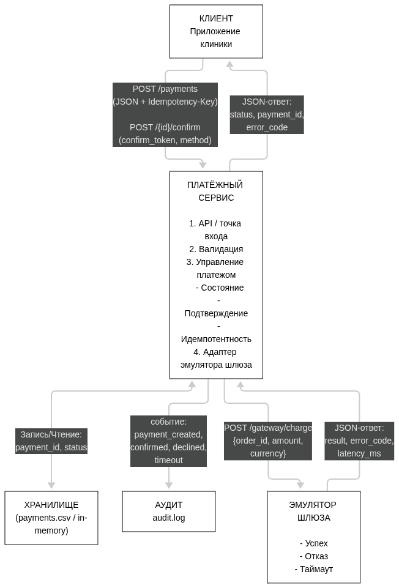
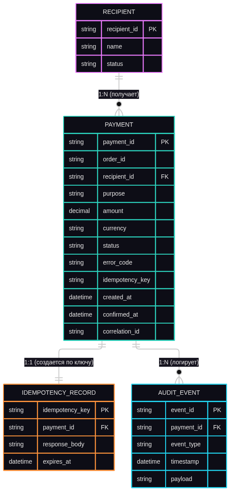
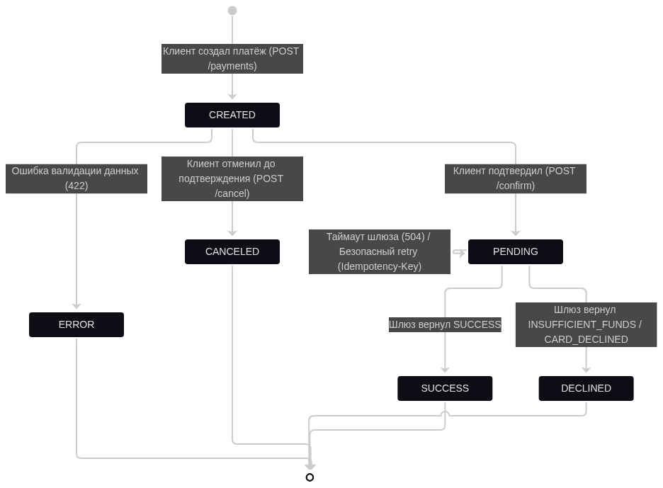
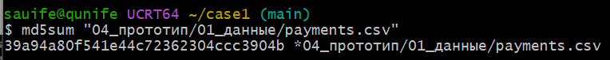
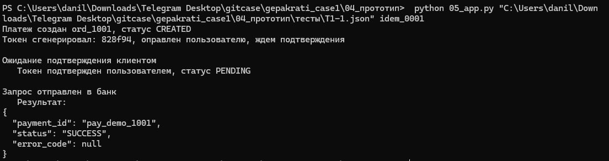
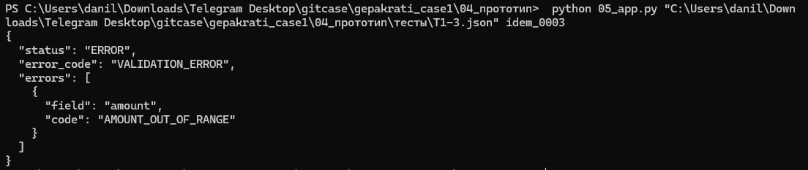

<div align="center">

### Министерство здравоохранения Российской Федерации
### Клиника «Мед-Сервис»

<br><br><br><br>

# ПРИЛОЖЕНИЕ К ПРОЕКТУ
## Кейс 1: «Платёжный сервис: безопасный платёж за услугу»

<br><br><br><br>

**Команда:** Гепакраты\
**Состав команды:**\
Леонов А.Л. (Аналитик)  
Гумеров К.М. (Разработчик)  
Голованов Д.А. (Тестировщик)  
Шарипов Т.М. (Презентатор)

<br><br><br><br><br><br>

Казань, 2026 г.

</div>

<!-- разрыв страницы в пдф -->
<div style="page-break-after: always;"></div>

## Оглавление
1. [А. Диаграммы](#а-диаграммы)
2. [B. Таблицы](#b-таблицы)
3. [С. Журнал промптов](#с-журнал-промптов)
4. [D. Матрица вклада](#d-матрица-вклада)
5. [Е. Артефакты](#е-артефакты)
6. [F. Чек-лист приложения](#f-чек-лист-приложения)

<div style="page-break-after: always;"></div>


## А. Диаграммы
### A.1. Схема системы


*Рис. А.1 — Схема архитектуры платёжного сервиса*

>Потоки данных: Клиент отправляет JSON-запрос и Idempotency-Key. Платёжный сервис валидирует данные, сохраняет их в хранилище, пишет события в аудит и вызывает эмулятор шлюза. Эмулятор возвращает статус (result, error_code, latency_ms), который сервис возвращает клиенту.

### A.2. ER-модель


*Рис. А.2 — ER-модель базы данных*

### A.3. Схема состояний платежа


*Рис. А.3 — Схема состояний платежа*

>Переходы: В PENDING платёж переводит клиент (успешное подтверждение). В SUCCESS/DECLINED — ответ эмулятора. В CANCELED — клиент (только до подтверждения). При таймауте шлюза статус остаётся PENDING для безопасного повторного запроса.

### A.4. Спецификация API (контракт)
Сервис спроектирован как REST API (полный контракт в 06_openapi.yaml). Для демонстрации логики (валидации, идемпотентности и работы с эмулятором) реализован консольный прототип. Форматы запросов и ответов ниже полностью соответствуют спецификации OpenAPI и схемам, используемым в прототипе. Консольный прототип валидирует формат входных данных, при передаче невалидного JSON или массива вместо объекта возвращается ошибка BAD_REQUEST (HTTP 400).

**Метод создания платежа:** `POST /api/v1/payments`

*Пример запроса:*
```json
{
  "order_id": "ord_1001",
  "recipient": "clinic_medservice",
  "purpose": "Приём терапевта",
  "amount": 2500.00,
  "currency": "RUB"
}
```

*Пример успешного ответа (HTTP 201 Created):*
```json
{
  "payment_id": "pay_0001",
  "status": "CREATED",
  "confirm_token": "token_xyz123",
  "expires_in": 600
}
```

*Пример ответа при ошибке валидации (HTTP 422 Unprocessable Entity):*
```json
{
  "error_code": "VALIDATION_ERROR",
  "message": "Ошибка валидации данных",
  "retryable": false,
  "details": [
    {"field": "amount", "code": "AMOUNT_OUT_OF_RANGE"}
  ]
}
```

**Метод подтверждения платежа:** POST /api/v1/payments/{id}/confirm

*Пример запроса:*
```json
{
  "confirm_token": "token_xyz123",
  "method": "card_token"
}
```


<div style="page-break-after: always;"></div>

## B. Таблицы
### B.1. Правила валидации
|ID|Условие|Действие|Код ошибки|Обоснование|
|-|-|-|-|-|
|V-1|обязательное поле пустое|отклонить|VALIDATION_ERROR|Без обязательных полей платёж невозможно исполнить.|
|V-2|order_id не по regex `^[A-Za-z0-9_\-]{1,64}$`|отклонить|INVALID_FORMAT|Единый формат защищает от инъекций и мусорных ключей.|
|V-3|amount ≤ 0 или > 1 000 000|отклонить|AMOUNT_OUT_OF_RANGE|Ограничивает мошенничество и ошибки ввода сумм.|
|V-4|currency не в [RUB]|отклонить|UNSUPPORTED_CURRENCY|Клиника принимает только рубли, иные валюты не поддерживаются.|
|V-5|recipient не в recipients.csv или INACTIVE|отклонить|RECIPIENT_NOT_FOUND|Нельзя платить неактивному/заблокированному получателю.|
|V-6|len(purpose)>200 или содержит номер карты (PAN)|отклонить|INVALID_PURPOSE|Запрет PAN защищает от утечки карточных данных, лимит длины — от переполнения.|
|V-7|amount имеет больше 2 знаков после точки|отклонить|INVALID_AMOUNT_PRECISION|Ограничение точности предотвращает ошибки округления.|
|V-8|order_id + recipient уже существует|Вернуть существующий платеж|DUPLICATE_ORDER|Дубликат заказа = риск двойного списания, возвращаем существующий.|
|V-9|повторение Idempotency-Key|Вернуть тот же ответ, что и при первом запросе|DUPLICATE_REQUEST|Идемпотентность гарантирует, что повтор не спишет деньги дважды.|

### B.2. Матрица «вход → код ошибки → HTTP»
| Ситуация (вход) | Код ошибки | HTTP-статус | Retryable | Действие клиента |
| :--- | :--- | :--- | :--- | :--- |
| Обязательное поле пустое (V-1) | `VALIDATION_ERROR` | 422 | Нет | Исправить запрос |
| `order_id` не по regex (V-2) | `INVALID_FORMAT` | 422 | Нет | Исправить `order_id` |
| `amount` ≤ 0 или > 1 000 000 (V-3) | `AMOUNT_OUT_OF_RANGE` | 422 | Нет | Исправить сумму |
| `currency` не RUB (V-4) | `UNSUPPORTED_CURRENCY` | 422 | Нет | Выбрать RUB |
| `recipient` не найден или не ACTIVE (V-5) | `RECIPIENT_NOT_FOUND` | 404 | Нет | Выбрать другого получателя |
| `purpose` > 200 символов или PAN (V-6) | `INVALID_PURPOSE` | 422 | Нет | Очистить назначение |
| `amount` > 2 знаков после точки (V-7) | `INVALID_AMOUNT_PRECISION` | 422 | Нет | Округлить до 2 знаков |
| Дубль `order_id` + `recipient` (V-8) | `DUPLICATE_ORDER` | 409 | Нет | Использовать существующий платеж |
| Повтор `Idempotency-Key` (V-9) | `DUPLICATE_REQUEST` | 200 | Да (тот же ответ) | Ничего не делать (успех) |
| Нет или неверный Bearer-токен | `UNAUTHORIZED` | 401 | Нет | Обновить токен авторизации |
| Платёж не найден (`GET /payments/{id}`) | `PAYMENT_NOT_FOUND` | 404 | Нет | Проверить `payment_id` |
| Попытка отмены после списания (`POST /cancel`) | `INVALID_STATE` | 409 | Нет | Оформить возврат (refund) |
| Истёк срок действия `confirm_token` | `TOKEN_EXPIRED` | 410 | Нет | Создать новый платёж |
| Превышен лимит запросов (Rate Limit) | `RATE_LIMITED` | 429 | Да (с задержкой) | Повторить позже |
| Недостаточно средств (от эмулятора) | `INSUFFICIENT_FUNDS` | 402 | Да (новый платёж) | Пополнить баланс/другая карта |
| Карта отклонена банком (от эмулятора) | `CARD_DECLINED` | 402 | Нет | Использовать другую карту |
| Таймаут эмулятора шлюза | `TIMEOUT` | 504 | Да (тот же ключ) | Повторить `confirm` |
| Некорректный JSON или файл не найден | `BAD_REQUEST` | 400 | Нет | Исправить тело запроса |
| Неверный код подтверждения (неверный токен) | `INVALID_CONFIRM_TOKEN` | 422 | Нет | Ввести верный код (дано 3 попытки) |
| Превышены 3 попытки ввода кода | `INVALID_CONFIRM_TOKEN` | 410 | Нет | Создать новый платёж |

> **Правило:** `retryable = Да` только для ответов **429** (Rate Limit), **402** (`INSUFFICIENT_FUNDS`) и **504** (`TIMEOUT`). Во всех случаях повторный запрос отправляется с тем же заголовком `Idempotency-Key`.

### B.3. Тесты

| ID | Цель | Входные данные (кратко) | Ожидаемый результат | Фактический результат (Факт) | Статус |
| :--- | :--- | :--- | :--- | :--- | :--- |
| **T1-1** | Успешная оплата | `ord_1001`, 2500.00 RUB | `SUCCESS`, HTTP 200/201 | `{"payment_id": "pay_demo_1001", "status": "SUCCESS", "error_code": null}` | **PASS** |
| **T1-2** | Отказ шлюза (нет средств) | `ord_1002`, 1800.00 RUB | `DECLINED`, `INSUFFICIENT_FUNDS`, HTTP 402 | `{"payment_id": "pay_demo_xxxxxx", "status": "DECLINED", "error_code": "INSUFFICIENT_FUNDS"}` | **PASS** |
| **T1-3** | Неверные данные (отриц. сумма) | `ord_1003`, -100.00 RUB | Ошибка валидации, HTTP 422 | `{"status": "ERROR", "error_code": "VALIDATION_ERROR", "errors": [{"field": "amount", "code": "AMOUNT_OUT_OF_RANGE"}]}` | **PASS** |
| **T1-4** | Идемпотентность (повтор) | `ord_1001`, повторный `confirm` с тем же ключом | `DUPLICATE_REQUEST`, HTTP 200 | `{"payment_id": "pay_demo_xxxxxx", "status": "SUCCESS", "error_code": "DUPLICATE_REQUEST"}` | **PASS** <br>*(после фикса)* |
| **T1-5** | Таймаут шлюза | `ord_1006_timeout_3` | Платёж остается `PENDING`, HTTP 504 | `{"payment_id": "pay_demo_ut_3", "status": "PENDING", "error_code": "UNKNOWN"}` | **PASS** <br>*(после фикса)* |


> **Примечание:**\
> В ходе первого прогона тестов были выявлены две логические ошибки в прототипе, которые затем были исправлены:
> 1. **T1-4 (Идемпотентность):** Изначально система возвращала `VALIDATION_ERROR` вместо `DUPLICATE_REQUEST`, так как срабатывала проверка дубля заказа (V-8) раньше проверки ключа идемпотентности (V-9). Приоритет проверок был изменён, теперь при повторном ключе система возвращает статус первого ответа.
> 2. **T1-5 (Таймаут):** Изначально при таймауте статус в базе записывался как `TIMEOUT`, что нарушало схему состояний (А.3). Ошибка была исправлена: теперь при таймауте статус корректно переводится в `PENDING` (ожидание), а клиенту возвращается ошибка `UNKNOWN` с HTTP 504 для безопасного ретрая.
> 
> Все начальные запросы, скриншоты (PNG) и итоговые ответы сохранены в папке `04_прототип/тесты`.

### B.4. Методы подтверждения и безопасность
Для подтверждения списания используется одноразовый токен `confirm_token`, который хранится на сервере, жестко привязан к `payment_id` и имеет TTL 10 минут. После успешного использования токен удаляется.

| Метод | Что эмулирует | Ограничения |
| :--- | :--- | :--- |
| `card_token` | Списание с токенизированной карты | По умолчанию, 3 попытки ввода |
| `sms_code` | Ввод кода из СМС | 3 попытки до статуса DECLINED |
| `biometric_stub` | Биометрия (FaceID/TouchID) | Требует оборудования |

*Правила безопасности:* При истечении TTL возвращается ошибка `TOKEN_EXPIRED` (HTTP 410). Другой клиент не может подтвердить чужой платеж, так как токен валидируется в контексте сессии.

### B.5. Сценарии эмулятора шлюза
Эмулятор предназначен для тестирования без реального эквайринга. Он детерминирован: исход зависит от `hash(order_id) mod 10`. Это позволяет автотестам гарантированно воспроизводить нужный сценарий. Искусственная задержка для эмуляции таймаута (по умолчанию 600 секунд, в тестах уменьшена до 5 секунд для скорости).

| Условие (остаток от деления) | Результат | Код ошибки | Искусственная задержка |
| :--- | :--- | :--- | :--- |
| `0..6` (70% случаев) | SUCCESS | — | 0–2 сек. |
| `7` (10% случаев) | DECLINED | `INSUFFICIENT_FUNDS` | 1 сек. |
| `8` (10% случаев) | DECLINED | `CARD_DECLINED` | 1 сек. |
| `9` (10% случаев) | TIMEOUT | `UNKNOWN` | Имитация зависания (`time.sleep`) |

*Логирование:* Каждый вызов эмулятора пишет JSON-строку в `gateway.log` с полями: `timestamp`, `order_id`, `status`, `error_code`, `duration_ms`.

<div style="page-break-after: always;"></div>

## С. Журнал промптов

| Дата | Цель | Промпт | Результат | Проверка | Использовано |
| :--- | :--- | :--- | :--- | :--- | :--- |
| 31.10.2026 | Распределить задачи команды и подготовить план работы над кейсом | Проанализировать материалы кейса; распределить обязанности между презентатором, аналитиком-архитектором, разработчиком и тестировщиком; составить инструкции по ролям. | Подготовлены инструкции по четырём ролям: обязанности, этапы, файлы, результаты и взаимодействие участников; составлен общий план. | Сверено с файлом информации о проекте. | Распределены роли и этапы выполнения задач; установлен первый общий дедлайн команды. |
| 01.11.2026 | Подготовить входные данные для пяти сценариев тестирования платёжного сервиса. | Создать JSON-запросы для сценариев: успешная оплата, отказ шлюза, неверная сумма, повторное подтверждение и таймаут; учитывать контракт проекта. | Подготовлены 5 JSON-файлов в папке кейс1\03_тесты и инструкция. | Сверено с 06_openapi.yaml: обязательные поля order_id, recipient, purpose, amount, currency. | Данные использованы: их типы соответствуют описанию с openapi.yaml. |
| 03.11.2026 | Научиться формировать уникальный идентификатор. | Как формировать уникальный идентификатор для базы данных в Python? | import uuid; uuid.uuid4().hex[:6]. | В будущем проверено тестами. | Использовано для формирования correlation_id. |

>Примечание:\
>Мы старались ограничить использование ИИ до минимума, и в основном использовали поисковые системы, поэтому журнал промптов получился совсем небольшим.  

<div style="page-break-after: always;"></div>

## D. Матрица вклада
| Участник | Файлы/задачи | Часы | Подпись |
| :--- | :--- | :--- | :--- |
| Гумеров К.М. | 05_app.py (прототип); gateway_emulator.py (эмулятор шлюза); README.md	 | 16 | _______ |
| Леонов А.Л. | 02_правила.md; 03_data_dictionary.md ; 06_openapi.yaml; | 12 | _______ |
| Голованов Д.А. | 03_тесты.md; gateway_emulator.py; 08_gateway_emulator.md; 02_правила.md | 13 | _______ |
| Шарипов Т.М. | 08_ER.md; 06_приложение.md; 06_приложение.pdf; 05_презентация.md; Презентация.pptx | 11 | _______ |

<div style="page-break-after: always;"></div>

## Е. Артефакты
- [GitHub команды](https://github.com/kamil2757/gepakrati_case1)

- Скриншот последнего коммита:


- Скриншот проверки целостности исходных данных:



- Скриншоты успешного прохождения тестов T1-1 и T1-3:





<div style="page-break-after: always;"></div>

## F. Чек-лист приложения

- ✅ Схема системы: 4–6 блоков, потоки подписаны (Раздел А.1)
- ✅ Схема состояний платежа с переходами (Раздел А.3)
- ✅ ER-модель (Раздел А.2)
- ✅ Спецификация API с примерами (Раздел А.4)
- ✅ Правила V-1…V-9 с обоснованием (Раздел В.1)
- ✅ Матрица «вход → код → HTTP → retryable» (Раздел В.2)
- ✅ Тесты T1-1…T1-5 с фактом (Раздел В.3)
- ✅ Методы подтверждения платежа (Раздел В.4)
- ✅ Сценарии эмулятора шлюза (Раздел В.5)
- ✅ Журнал промптов (Раздел С)
- ✅ Матрица вклада: 4 человека, задачи разные (Раздел D)
- ✅ Git-ветка, коммит и скриншоты прототипа (Раздел Е)
- ✅ Скрин прототипа (если есть)
- ✅ Файл экспортирован в PDF до начала защиты

