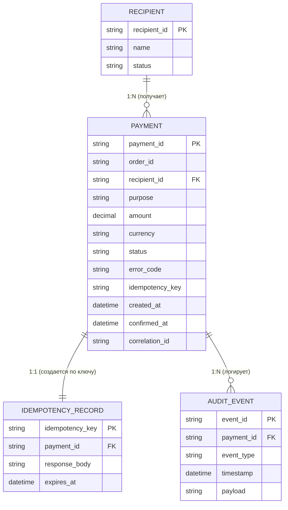

# ER-модель базы данных

В прототипе данные хранятся в CSV, но для реального продукта спроектирована реляционная модель.

## Сущности и их атрибуты

### 1. Payment (Платеж)
- `payment_id` (PK) — уникальный ID платежа.
- `order_id` — ID заказа.
- `recipient_id` (FK) — ссылка на получателя.
- `purpose` — назначение платежа.
- `amount` — сумма.
- `currency` — валюта.
- `status` — статус (CREATED, PENDING, SUCCESS, DECLINED, ERROR, CANCELED).
- `error_code` — код ошибки (если есть).
- `idempotency_key` — ключ идемпотентности.
- `created_at` — время создания.
- `confirmed_at` — время подтверждения.
- `correlation_id` — ID для трассировки.

### 2. Recipient (Получатель)
- `recipient_id` (PK) — уникальный ID получателя.
- `name` — название ("Клиника Мед-Сервис").
- `status` — статус (ACTIVE, INACTIVE, PENDING, BLOCKED).

### 3. IdempotencyRecord (Запись идемпотентности)
- `idempotency_key` (PK) — ключ из заголовка (8–64 символа).
- `payment_id` (FK) — ссылка на созданный платеж.
- `response_body` — сохраненный JSON-ответ для повторной выдачи.
- `expires_at` — время жизни ключа (24 часа).

### 4. AuditEvent (Событие аудита)
- `event_id` (PK) — уникальный ID события.
- `payment_id` (FK) — ссылка на платеж.
- `event_type` — тип (PAYMENT_CREATED, PAYMENT_CONFIRMED, GATEWAY_DECLINED и т.д.).
- `timestamp` — время события.
- `payload` — детали события (JSON).

---

## Связи (Relationships)

1. **Recipient (1) — (N) Payment**  
   Один получатель может иметь много платежей. У платежа есть один получатель.

2. **Payment (1) — (1) IdempotencyRecord**  
   Один платеж создается по одному уникальному ключу идемпотентности.

3. **Payment (1) — (N) AuditEvent**  
   У одного платежа может быть множество событий в журнале аудита.

---

## Диаграмма (Mermaid)
